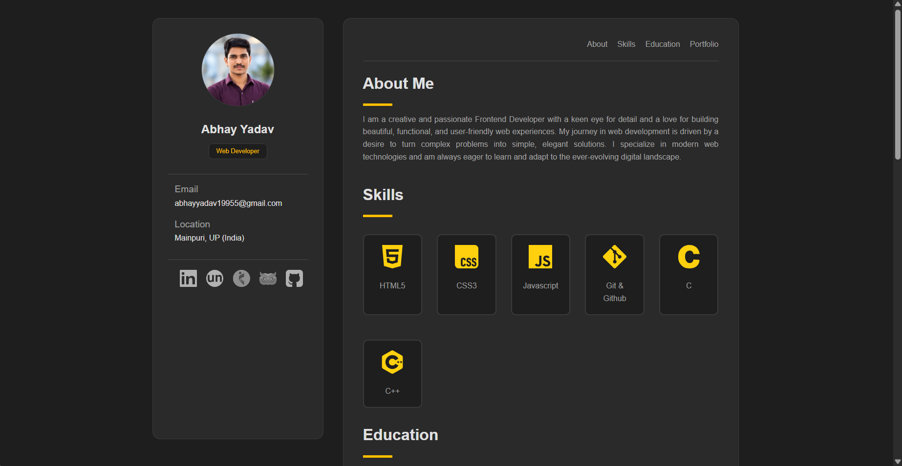

<div align="center">

# Abhay Yadav | Portfolio

A clean, responsive personal portfolio to showcase my skills, education and projects.

[](https://abhayyadav0090.github.io/portfolio2/)
[](https://github.com/abhayyadav0090)
[](https://www.linkedin.com/in/abhay-yadav-6923742b5)


</div>

---

## Preview



## About

This is my personal portfolio website. It has a fixed sidebar with my profile and contact links, and a main area with About, Skills, Education and Portfolio sections. It is built with plain HTML and CSS, so it is fast and has no dependencies.

## Features

- Sidebar with profile photo, email, location and social links
- Smooth navigation to About, Skills, Education and Portfolio
- Skills grid with technology icons
- Education timeline
- Project cards with screenshot, description and tech tags
- Responsive layout for desktop, tablet and mobile
- No frameworks or build step

## Projects Showcased

| Project | Description | Tech | Link |
|---|---|---|---|
| **Productivity Website (NexOS)** | A website to manage tasks and improve productivity | HTML, CSS, JavaScript, Node.js, Express, MongoDB | [Live](https://ai-aqit.onrender.com/) |
| **Kartik Maas** | A 30-day daily practice tracker with login and progress analysis | HTML, CSS, JavaScript, Node.js, Express, MongoDB | [Live](https://kartik-maas.onrender.com/) |
| **Jan Samadhan** | A community platform to report local issues, with AI help using the Gemini API | React, Node.js, Express, MongoDB, Tailwind CSS | [Live](https://jana-samadhan.vercel.app/) |
| **MERN Practice** | MERN stack exercises, daily class learnings and deployments | HTML, CSS | [Live](https://abhayyadav0090.github.io/MERN-Practice/) |
| **Simple Portfolio** | A basic portfolio to show skills and projects | HTML, CSS | [Live](https://abhayyadav0090.github.io/portfolio2/) |

## Project Structure

```
portfolio2/
├── index.html      # Page structure and content
├── style.css       # All styling and responsive rules
├── PNGs/           # Profile photo, project screenshots and icons
└── README.md
```

## Run Locally

```bash
# 1. Clone the repository
git clone https://github.com/abhayyadav0090/portfolio2.git

# 2. Go to the folder
cd portfolio2

# 3. Open index.html in your browser
```

You can also use the **Live Server** extension in VS Code for auto-reload while editing.

## Customize It

1. Change your name, role, email and location in the `profile` and `contact` blocks of `index.html`.
2. Replace `PNGs/profile.png` with your own photo.
3. Update the social links in the `social` block.
4. To add a project, copy one `project` block inside `#portfolio`, then change the link, image, title, description and tags.

## Deployment

The site is hosted on **GitHub Pages**:

1. Go to **Settings → Pages** in the repository.
2. Under **Source**, select the `main` branch and the `/ (root)` folder.
3. Save, and the site goes live at `https://<username>.github.io/portfolio2/`.

## Contact

- Email: [abhayyadav19955@gmail.com](mailto:abhayyadav19955@gmail.com)
- LinkedIn: [Abhay Yadav](https://www.linkedin.com/in/abhay-yadav-6923742b5)
- GitHub: [@abhayyadav0090](https://github.com/abhayyadav0090)
- Codolio: [Abhayyadav0090](https://codolio.com/profile/Abhayyadav0090)

---

<div align="center">

If you like this project, give it a star ⭐

</div>
